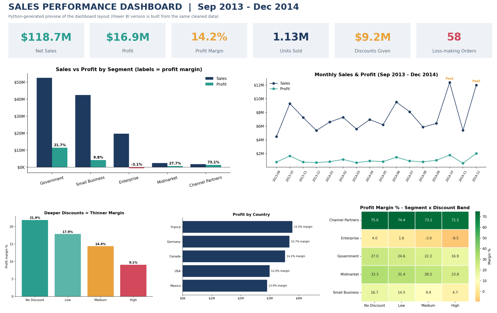

# Sales Performance Analysis - End-to-End Case Study
**Beeskilled x Axcentra Internship | Week 4 Capstone: Data Visualization & Analysis**
Author: *<Your Name>*  |  LinkedIn: *<your link>*

> **Business question:** Where does the company make (and lose) money, and what should leadership do about it?


## Key findings
| # | Finding | Evidence |
|---|---|---|
| 1 | Business is growing fast | Like-for-like (Sep-Dec) sales **+36.9%**, profit **+40.1%** (2014 vs 2013) |
| 2 | Government is the profit engine | **67%** of profit ($11.4M, 21.7% margin) |
| 3 | **Enterprise loses money** | -$0.6M on $19.6M sales; list price $125 vs cost $120 = only 4% margin before discounts |
| 4 | Discounts erode margin in every segment | 21.9% (none) -> 17.9% (low) -> 14.4% (medium) -> **9.1%** (high) |
| 5 | Under-sold profitable segments | Channel Partners 73% margin, Midmarket 28%, only 3.5% of sales together |
| 6 | Strong Q4 seasonality | Oct and Dec 2014 about $12M each |

**Headline numbers:** $118.7M net sales | $16.9M profit | 14.2% margin | 1.13M units | 700 orders | 58 loss-making orders (all Enterprise)

## Recommendations
1. Cap Enterprise discounts at about 2.5% or raise its price -> about **+$1.0M** profit (illustrative).
2. Require approval for High-band discounts (>10%) -> up to **+$2.2M** (overlaps with #1).
3. Grow Channel Partners and Midmarket; protect Government accounts.
4. Plan stock/staffing for Q4 peaks; pilot pricing changes before full rollout.

## Project structure
```
Capstone_Sales_Analysis/
├── 01_Data/
│   ├── Sample_data_raw.xlsx          # original dataset
│   └── sales_clean.csv               # cleaned data (use this in Power BI)
├── 02_Code/
│   ├── 01_clean_and_analyze.py       # cleaning + analysis + charts (Python/Pandas)
│   ├── 02_sql_analysis.sql           # 13 MySQL queries (window functions, CTEs)
│   ├── 03_analysis_notebook.ipynb    # narrated notebook with outputs
│   ├── 04_build_report.py            # builds the PDF reports
│   └── 05_build_excel_dashboard.py   # builds the Excel dashboard
├── 03_Dashboard/
│   ├── Sales_Dashboard.xlsx          # Excel dashboard (formula-driven, 4 charts)
│   ├── PowerBI_Build_Guide.md        # DAX + layout for the Power BI dashboard
│   ├── dashboard_preview_python.png
│   ├── charts/                       # 8 PNG charts
│   └── summary_by_*.csv              # aggregated tables
├── 04_Report/
│   ├── Final_Report.pdf              # charts, findings, recommendations
│   └── Stakeholder_Summary.pdf       # 1-page summary for presentation
├── requirements.txt
└── README.md
```

## How to reproduce
```bash
pip install -r requirements.txt
python 02_Code/01_clean_and_analyze.py     # cleans data, writes sales_clean.csv + charts
python 02_Code/04_build_report.py          # builds both PDFs
python 02_Code/05_build_excel_dashboard.py # builds the Excel dashboard
# SQL: create the table in MySQL Workbench, import 01_Data/sales_clean.csv, run 02_Code/02_sql_analysis.sql
```

## Methodology
1. **Clean (Python):** trimmed header spaces; 53 blank Discount Bands relabelled "No Discount" (all had $0 discounts); validated `Gross - Discounts = Sales` and `Sales - COGS = Profit` on all 700 rows; 0 duplicates.
2. **Analyse (Pandas + SQL):** segment/country/product/discount/time analysis; ranking, running totals, MoM growth via window functions.
3. **Visualise (Excel + Power BI):** KPI cards, segment, trend, discount and heatmap views.
4. **Communicate:** insight-led report and 1-page stakeholder summary.

## Data-quality notes (honest caveats)
- 2013 contains only Sep-Dec, so growth is compared **like-for-like (Sep-Dec)**; full-year would wrongly show +249%.
- `Manufacturing Price` does not reconcile to COGS per unit (only 164/700 rows match); **COGS used as reported**.
- 36 rows have half-unit quantities; kept as reported.
- Discount scenarios assume unchanged volume and are illustrative upper bounds.

## Tools
Python (Pandas, Matplotlib, Seaborn) | MySQL | Excel | Power BI | ReportLab | Jupyter
